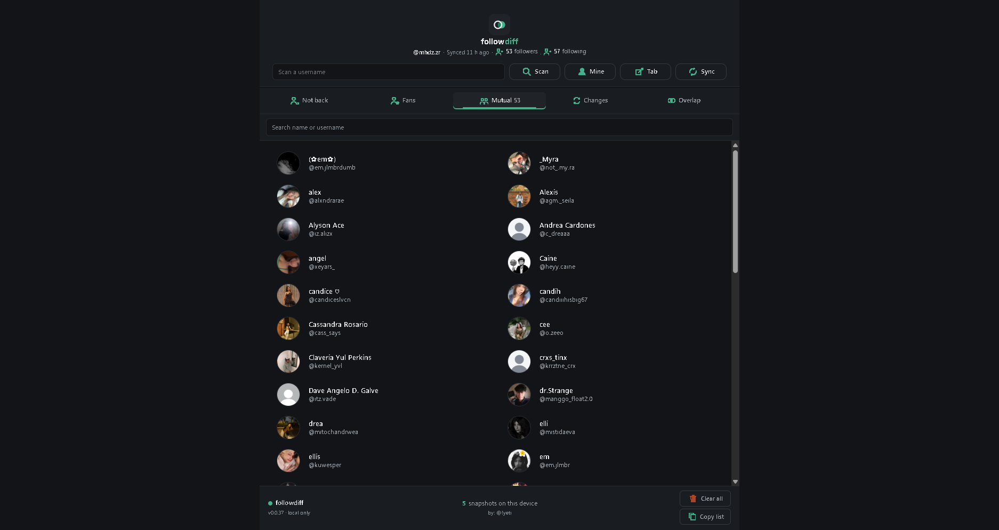
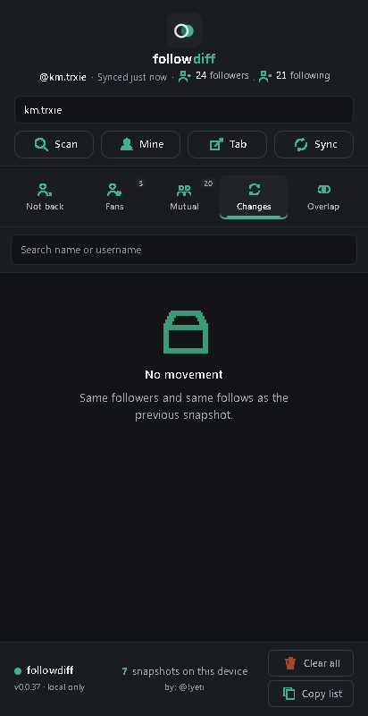
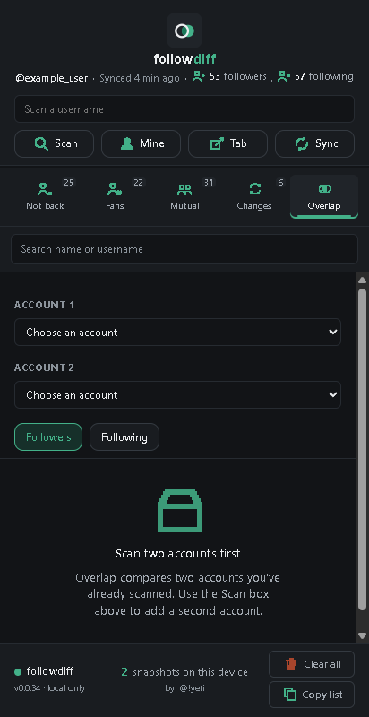

# FollowDiff

> See who follows you back, who doesn't, and what changed — without sending a single byte off your machine.

**FollowDiff** is a read-only Chrome/Brave extension for Instagram. It snapshots your followers and following lists locally, diffs them, and shows you the truth: who doesn't follow back, who your fans are, mutuals, and what changed since last time.

---

## 💭 Why I built this

I'm a private person. I don't want a big following or a big audience — I just want my numbers to match. Following and followers should be the same count. When they're not, I want to know who's not following me back so I can decide what to do about it.

Instagram doesn't show you this clearly. It shows you a count, but not the diff. And every third-party tool I tried wanted my password, sent my data somewhere, or was full of ads.

FollowDiff exists because I wanted a tool that:
- **Shows the truth** — who doesn't follow back, who your fans are, mutuals, and what changed
- **Stays on my machine** — no server, no account, no analytics, no telemetry
- **Is read-only** — it never touches my account, never follows or unfollows anyone
- **Is honest** — no upsells, no paywalls for basic info, no ads

That's it. A simple, private, honest tool.

---

## ✨ Features

- **Not back** — people you follow who don't follow you back
- **Fans** — people who follow you but you don't follow back
- **Mutual** — accounts you both follow each other
- **Changes** — new followers, lost followers, new follows, unfollows since your last sync
- **Overlap** — compare two accounts' follower/following lists
- **Keep list** — whitelist accounts so they never show up in diffs
- **Avatars** — real profile pictures, loaded locally
- **Side panel + full tab** — use it in Brave/Chrome's side panel or open it as a full tab
- **100% local** — nothing leaves your browser. No accounts, no analytics, no telemetry

---

## 📸 Screenshots

<!-- Replace with real screenshots -->
### Screenshots

| Panel | Changes | Overlap |
|---|---|---|
|  |  |  |

---

## 🚀 Installation

### Chrome Web Store (recommended)
> Coming soon. Submission in progress.

### Manual (developer mode)
1. Download the latest release from [Releases](https://github.com/yetilukoss/followdiff/releases)
2. Unzip
3. Open `brave://extensions` (or `chrome://extensions`)
4. Enable **Developer mode**
5. Click **Load unpacked** → select the unzipped folder

---

## 🧠 How it works

FollowDiff talks to Instagram's own web API using your existing session cookies — the same way the Instagram website does. It never asks for your password.

- **Read-only.** It only reads your follower/following lists. It never follows, unfollows, likes, or messages anyone.
- **Local storage only.** Snapshots are stored in `chrome.storage.local` on your device. Up to 12 snapshots per account.
- **No network calls to third parties.** The only network requests are to `instagram.com` and its CDN for avatars.
- **No account required.** No sign-up, no email, no tracking.

See [PRIVACY.md](policies/PRIVACY.md) for the full privacy policy.

---

## 🎮 Usage

1. Log in to Instagram in your browser
2. Open the FollowDiff side panel (click the extension icon)
3. Press **Sync** — FollowDiff reads your lists and saves a snapshot
4. Switch between tabs: **Not back**, **Fans**, **Mutual**, **Changes**, **Overlap**
5. Use **Scan** to sync any other public account (type `@username`)
6. Use **Mine** to sync your own account again
7. **Pin** (★) accounts to keep them out of every diff
8. **Clear all** to wipe history

### Keyboard shortcuts
| Key | Action |
|---|---|
| `/` | Focus search |
| `1`–`5` | Switch tabs |
| `r` | Sync |
| `Esc` | Clear search |

---

## 🔒 Privacy

- No data collection. No analytics. No telemetry.
- All data stays in `chrome.storage.local` on your device.
- Instagram's session cookies are used only to read your lists, never transmitted elsewhere.
- Full policy: [PRIVACY.md](policies/PRIVACY.md)

---

## 🐛 Bug reports

Found a bug? Open an issue:

- [Report a bug](https://github.com/yetilukoss/followdiff/issues/new?template=bug_report.yml)
- [Request a feature](https://github.com/yetilukoss/followdiff/issues/new?template=feature_request.yml)

Please include your browser, extension version, and steps to reproduce. **Do not include your Instagram username or account data in public issues.**

---

## 📋 Changelog

See [CHANGELOG.md](CHANGELOG.md) for version history.

---

## ❓ FAQ

### Why does the follower count differ from Instagram's?

Instagram's displayed count and FollowDiff's count can differ for several reasons:

- **Pending requests.** Instagram counts follow requests you've sent or received that haven't been accepted yet. FollowDiff only counts confirmed followers/following.
- **Deactivated / restricted accounts.** Instagram may still count accounts that have been deactivated or restricted. FollowDiff only sees accounts returned by the API.
- **Rounding.** Instagram rounds large counts (e.g., "1.2K"). FollowDiff shows exact numbers.
- **Timing.** Counts change between when you open Instagram and when you sync. A follow/unfollow in between will cause a mismatch.
- **API pagination.** For very large accounts (1000+), Instagram may truncate or rate-limit pages. FollowDiff stops at 200 pages (10,000 entries) per list and reports what it collected.

If the difference is large or consistent, open an issue with your follower/following counts (not your username).

---

## 🤝 Contributing

Source code is maintained in a private repository. Bug reports and feature requests are welcome via [Issues](https://github.com/yetilukoss/followdiff/issues).

---

## 📋 Policies

| Document | Description |
|---|---|
| [Privacy Policy](policies/PRIVACY.md) | What data is stored, where, and why |
| [Terms of Service](policies/TERMS.md) | Usage terms and disclaimers |
| [Disclaimer](policies/DISCLAIMER.md) | Not affiliated with Meta/Instagram |
| [Security Policy](policies/SECURITY.md) | How to report vulnerabilities |
| [Code of Conduct](policies/CODE_OF_CONDUCT.md) | Community guidelines |

---

## 📜 License

MIT — see [LICENSE](LICENSE).

---

## 🙏 Credits

Built by **@!yeti**.

---

  FollowDiff is not affiliated with, endorsed by, or sponsored by Meta or Instagram.

